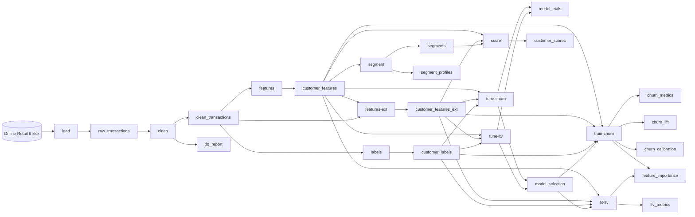
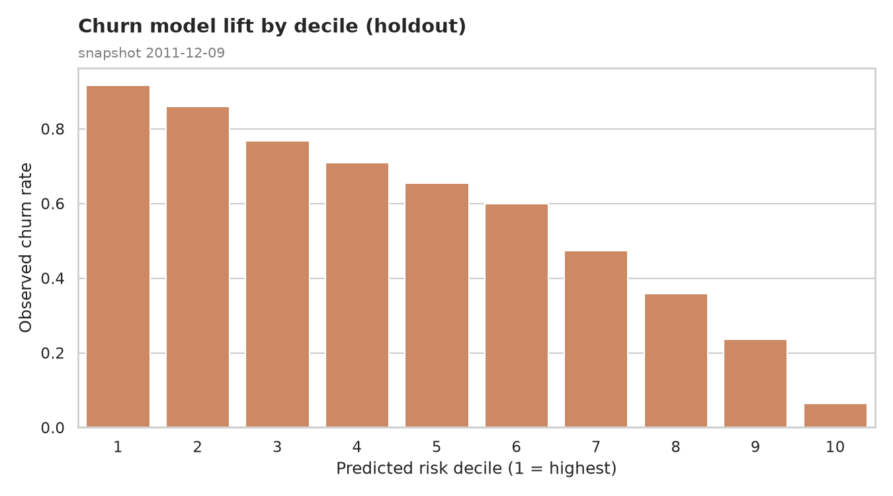
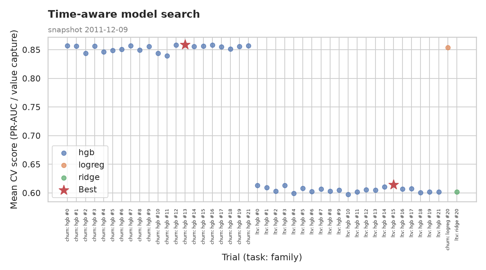
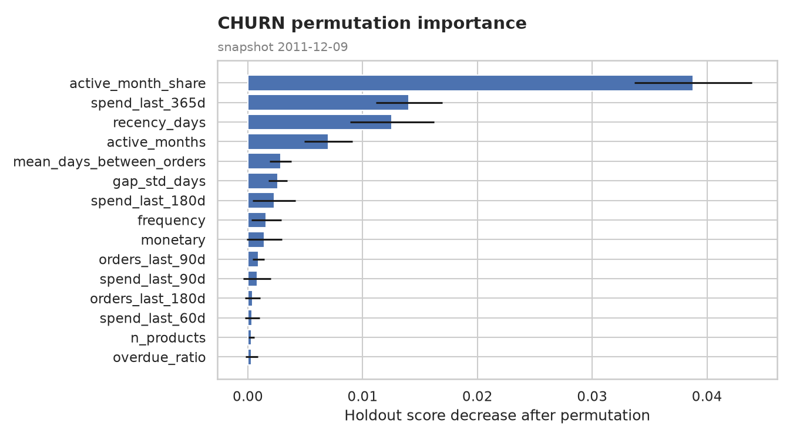
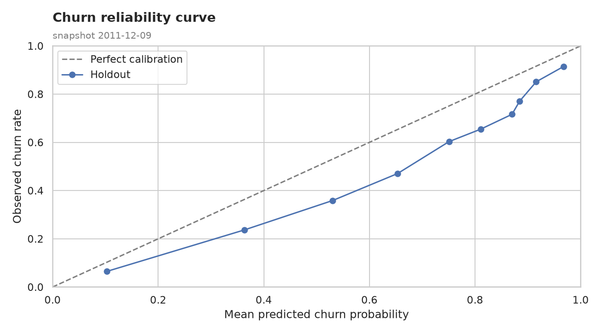
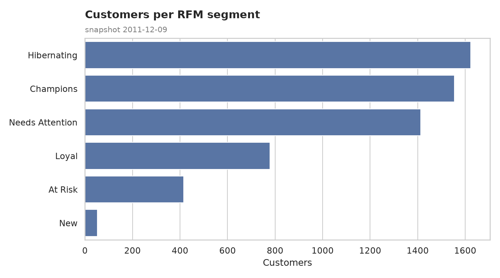
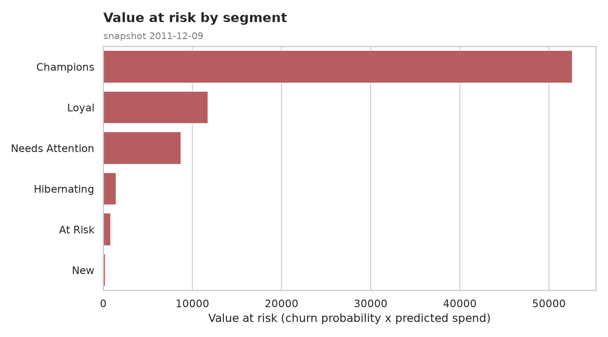
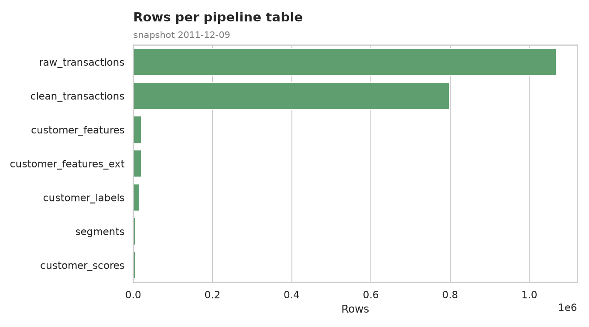
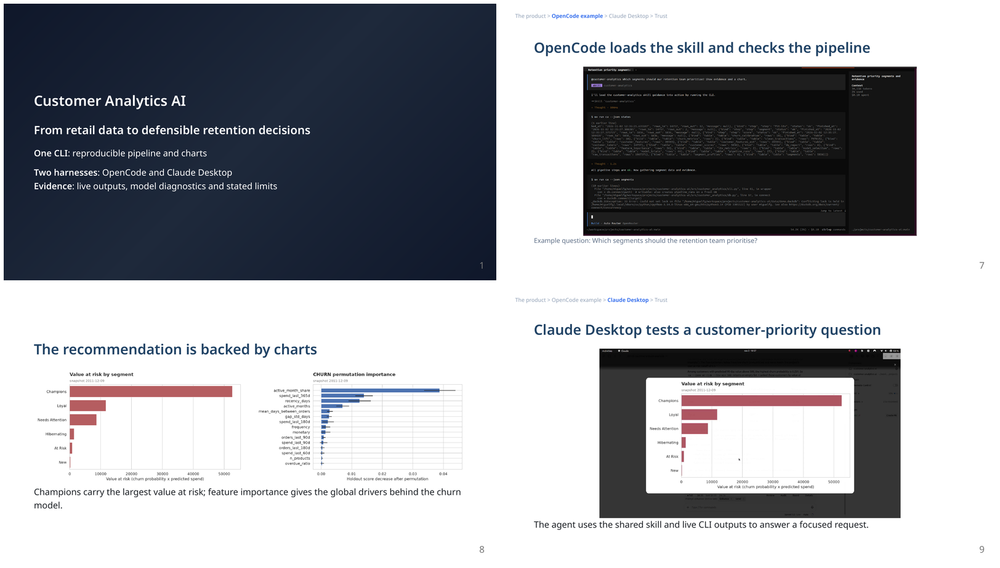

# Customer Analytics AI

An end-to-end data science and AI application for identifying churn risk, ranking customer value and supporting retention decisions on open retail data: an end-to-end pipeline (load → clean → features → behavioural features → tuning → churn → LTV → segments → scores → charts) stored step by step in DuckDB, driven by a JSON-emitting CLI, with an AI skill and a Claude SDK agent on top of the same commands.

See [TODO.md](TODO.md) for the next hands-on harness test and business/recruiter presentation steps.

## Pipeline



Every intermediate table is queryable with `ca query`. Snapshots: `train_early` = max date − 270 d, `train` = max date − 180 d, `holdout` = − 90 d, `current` = max date; labels look 90 days forward.

## Quickstart

Requires [uv](https://docs.astral.sh/uv/) and the Python version in `.python-version`.

```bash
make install   # uv sync
make data      # download + load raw data, then clean (skipped if data/ already has it)
uv run ca run-all --tune  # all steps, including 20 random configs + linear/default per model
make charts    # render all PNGs into charts/
```

`data/demo.duckdb` is not committed: `make data pipeline` downloads the dataset and builds it from source (tuning adds runtime; see measured results below). Plain `make pipeline` / `make run-all` skips search and uses saved selections when present, otherwise defaults.

Every command accepts `--db PATH` and `--json`. With `--json` it prints one envelope: `{"ok": true, "command": ..., "result": ...}` on success, or `{"ok": false, "command": ..., "error": ...}` with exit code 2 on failure.

## CLI reference

Output of `ca --help`:

```text
Usage: ca [OPTIONS] COMMAND [ARGS]...

  Customer analytics pipeline: load, model, segment, score and query.

Options:
  --db PATH  DuckDB file.
  --json     Machine-readable JSON envelope.
  --help     Show this message and exit.

Commands:
  ask          Answer QUESTION with the Claude agent (needs...
  at-risk      Customers likely to churn, by value at risk.
  chart        Render chart NAME to a PNG and return the plotted data.
  clean        Clean raw transactions and write the DQ report.
  customer     Score, features and recent invoices of one customer.
  features     Build features and labels per snapshot.
  features-ext Build behavioural customer features.
  fit-ltv      Fit the 90-day LTV regressor.
  load         Download (if needed) and load the raw Online Retail II data.
  model-report Metrics, model choices and top global feature importances.
  query        Run one read-only SQL statement.
  run-all      Run the whole pipeline (loads raw data only if missing).
  score        Score every current customer (churn, LTV, value at risk).
  segment      Compute RFM segments and KMeans clusters.
  segments     Segment profiles with churn and value at risk.
  status       Latest status per step and table row counts.
  train-churn  Train the churn model against the recency baseline.
  tune         Tune both models (--n-iter 20 by default).
  tune-churn   Tune churn by expanding-window PR-AUC.
  tune-ltv     Tune LTV by expanding-window top-decile value capture.
```

Make targets: `data`, `pipeline` / `run-all`, `status`, `load`, `clean`, `features`, `features-ext`, `tune`, `train-churn`, `fit-ltv`, `segment`, `score`, `charts`, `ask`, `test`, `lint`, `format`. For JSON model diagnostics use `uv run ca --json model-report`. `run-all --tune --from ...` requires starting at `train-churn` or an earlier step.

## Results

Data cleaning (`ca clean`, from `dq_report`): 1,067,371 raw rows → 797,815 clean rows.

| Check | Rows affected | Action |
|---|---:|---|
| null_customer_id | 243,007 | dropped |
| exact_duplicates | 26,479 | deduplicated |
| non_positive_price | 70 | dropped |
| cancellations | 18,390 | kept, `is_return=true` |
| non_positive_quantity_not_cancelled | 0 | dropped |

### Churn vs recency baseline

Tuned run on 2026-11-02; holdout has 5,244 customers and a 56.4% churn rate. Diagnostics fit on 9,513 rows from `train_early ∪ train`. The holdout also participates in model selection; see the caveat below.

| Model | PR-AUC | ROC-AUC | Precision@10 | Lift@10 | Brier |
|---|---:|---:|---:|---:|---:|
| Calibrated HGB | 0.823 | 0.805 | 0.916 | 1.62 | 0.194 |
| Recency baseline | 0.800 | 0.763 | 0.912 | 1.62 | n/a |

The top 10% means exactly 525 customers (`ceil(0.1 × 5244)`), with ties resolved by row order. Recency is a ranking score, so its Brier score is undefined.

| Decile | Customers | Churn rate | Lift |
|---|---:|---:|---:|
| 1 | 525 | 91.6% | 1.62 |
| 2 | 524 | 86.1% | 1.53 |
| 3 | 524 | 76.7% | 1.36 |
| 4 | 525 | 70.9% | 1.26 |
| 5 | 524 | 65.5% | 1.16 |
| 6 | 524 | 59.9% | 1.06 |
| 7 | 525 | 47.4% | 0.84 |
| 8 | 524 | 35.9% | 0.64 |
| 9 | 524 | 23.7% | 0.42 |
| 10 | 525 | 6.5% | 0.11 |



### LTV (90-day spend)

Holdout, currency scale; the regression target is `log1p(future_spend_90d)`.

| Model | MAE | RMSE | Spearman | Top-10% value capture |
|---|---:|---:|---:|---:|
| HGB | 435.3 | 2826.6 | 0.576 | 57.4% |
| Last-90-day spend baseline | 415.7 | 2203.1 | 0.466 | 55.9% |

The tuned LTV model ranks customers better and captures more actual future value in its top decile than the baseline, but its MAE and RMSE are worse. Search optimises value capture, not MAE. Use these predictions as a ranking aid, not calibrated spending amounts.

### Model improvements

The modeling process adds purchase rhythm, recent spending, basket size, returns and seasonality features to RFM. `ParameterSampler` searches gradient-boosting configurations against scaled logistic-regression and Ridge alternatives across two expanding time folds. Churn selection optimises PR-AUC; LTV selection optimises top-decile value capture, with Spearman correlation as a tie-breaker. Both selected gradient boosting. Churn probabilities use `CalibratedClassifierCV` with isotonic calibration; `permutation_importance` measures global predictive contributions. Selected models are evaluated, refit for current-customer scoring, and exposed through the CLI and tool-calling AI assistant.

Historical numbers below are from the previous README; new numbers are the actual full-data tuned run. Evaluation fitting also changed from `train` to `train_early ∪ train`, and churn is now calibrated, so this is not a controlled feature-only comparison.

| Metric | Before | After | Current baseline |
|---|---:|---:|---:|
| Churn PR-AUC ↑ | 0.809 | 0.823 | 0.800 |
| Churn precision@10 ↑ | not recorded | 0.916 | 0.912 |
| Churn lift@10 ↑ | not recorded | 1.62 | 1.62 |
| Churn Brier ↓ | not recorded | 0.194 | n/a |
| LTV MAE ↓ | 418.0 | 435.3 | 415.7 |
| LTV Spearman ↑ | 0.550 | 0.576 | 0.466 |
| LTV top-10% capture ↑ | not recorded | 57.4% | 55.9% |

The historical baseline Spearman was reported as 0.467; this fresh run is 0.466. Churn PR-AUC and LTV ranking improved against the historical model; LTV MAE worsened. Newly added metrics have no recorded before values.

Both model families selected HGB from 22 candidates each (20 random configurations plus a linear model and the original default). Expanding-window mean CV scores: churn 0.8588 PR-AUC, LTV 0.6142 value capture. Search took 17.92 s + 15.89 s = **33.81 s**, below the 5-minute budget, with OpenMP/BLAS threads limited to 2. All 11 steps, including local-workbook load, logged `ok`; loading took 62.67 s.

Selected parameters (seed 42):

- **churn** (`hgb`): `{"l2_regularization": 0, "learning_rate": 0.02, "max_depth": 3, "max_features": 0.5, "max_iter": 100, "min_samples_leaf": 100}`
- **ltv** (`hgb`): `{"l2_regularization": 1, "learning_rate": 0.05, "max_depth": 2, "max_features": 0.5, "max_iter": 200, "min_samples_leaf": 20}`

Top global permutation importances (five repeats, seed 42):

| Model | Feature | Mean score decrease | Std |
|---|---|---:|---:|
| churn | `active_month_share` | 0.0388 | 0.0051 |
| churn | `spend_last_365d` | 0.0140 | 0.0029 |
| churn | `recency_days` | 0.0126 | 0.0036 |
| churn | `active_months` | 0.0070 | 0.0021 |
| churn | `mean_days_between_orders` | 0.0028 | 0.0010 |
| ltv | `spend_last_365d` | 0.2163 | 0.0031 |
| ltv | `active_month_share` | 0.1997 | 0.0061 |
| ltv | `spend_last_180d` | 0.1027 | 0.0022 |
| ltv | `active_months` | 0.0976 | 0.0025 |
| ltv | `spend_last_90d` | 0.0727 | 0.0025 |

Churn importance measures PR-AUC decrease; LTV measures the increase in MAE on the log target. Correlated features can share importance. These are global predictive associations, not individual or causal explanations.

**Validation limit:** tuning uses `holdout` as its second validation fold. Reported tuned holdout results therefore include selection bias and are not an untouched test estimate. An additional future time window is needed to establish generalisation. The final scoring models are separately refit on `train ∪ holdout`.







`ca chart feature-importance --segment ltv` renders the LTV importance chart (the same filename is reused). `ca --json model-report` returns both metric tables, selected configurations, and the top five features per model.

### Segments

Current snapshot: 5,836 customers, RFM quintile rules (first match wins).

| Segment | Customers | Share | Avg recency (days) | Avg frequency | Avg monetary | Total monetary |
|---|---:|---:|---:|---:|---:|---:|
| Hibernating | 1,623 | 27.8% | 454 | 1.3 | 417 | 676,753 |
| Champions | 1,555 | 26.6% | 19 | 15.0 | 7,477 | 11,626,647 |
| Needs Attention | 1,422 | 24.4% | 66 | 2.2 | 759 | 1,079,329 |
| Loyal | 779 | 13.3% | 198 | 8.7 | 3,244 | 2,527,162 |
| At Risk | 405 | 6.9% | 367 | 3.4 | 1,083 | 438,616 |
| New | 52 | 0.9% | 51 | 1.0 | 357 | 18,563 |

Champions are a quarter of customers and about 71% of total monetary value (11.6M of about 16.4M across segments).





### Pipeline funnel



## Ask it in natural language

There are two ways to query the same commands:

1. **Agent skill** in `skills/customer-analytics/SKILL.md`. The checkout exposes it through `.claude/skills`, `.codex/skills`, `.opencode/skills` and `.agents/skills`, so Claude Code, Codex and OpenCode can discover it without a global install. The skill maps business questions to `ca ... --json` commands, then answers with a decision, key numbers, chart paths and caveats. Pi does not have a documented project-local skill directory; start it with `Read skills/customer-analytics/SKILL.md and follow it for this session.`

2. **Claude SDK agent** in `src/customer_analytics/agent.py`, run with `ca ask "<question>"`. It needs `ANTHROPIC_API_KEY` (see `.env.example`); the model comes from `CA_MODEL`, default `claude-sonnet-5-5`. `ca ask --eval` runs the 10-question set in `evals/questions.yaml`.

See [OpenCode example 1](assets/opencode-example-1.md) for a recorded skill-driven retention-priority answer and the charts it used.

### Recorded Claude Desktop example

The previous short cut has been retired while a revised recording is prepared. See the [example notes](assets/demos/claude-desktop-at-risk-example.md) for the decision boundary and evidence it will show.

### Recruiter slideshow

[](showcase/cli-agent-examples/customer-analytics-ai-cli.html)

[Open the HTML slideshow](showcase/cli-agent-examples/customer-analytics-ai-cli.html) or [download the PowerPoint deck](showcase/cli-agent-examples/customer-analytics-ai-cli.pptx). It covers the CLI, both agent examples, their evidence screenshots and the charts they produced.

Example questions the skill and agent are meant to answer:

- "Which high-LTV customers are likely to churn, and what offer would you send?" → `at-risk` + `chart top-at-risk`
- "What share of customers are Champions?" → `segments`
- "How healthy is the data pipeline?" → `status`

The agent's answers have not been recorded in this README. Run them locally to see actual output.

## Design decisions

- **DuckDB built from source.** `data/demo.duckdb` is git-ignored; `ca load` downloads UCI Online Retail II and `ca run-all` rebuilds every intermediate table, so the DB is reproducible rather than versioned.
- **scikit-learn LTV instead of `lifetimes`.** LTV uses `HistGradientBoostingRegressor` on 90-day forward spend. The baseline is last-90-day spend.
- **Time-based selection and evaluation.** Search uses expanding folds: `train_early → train`, then `train_early ∪ train → holdout`. Diagnostics evaluate the selected model fit on `train_early ∪ train`; churn uses isotonic calibration with 3-fold CV inside that fit. Both saved models are newly refit on `train ∪ holdout` for scoring `current`.
- **Selection caveat.** The holdout participates in hyperparameter selection (fold 2), so reported tuned holdout metrics are selection-biased, not an untouched test estimate. Snapshot rows can repeat the same customer, and calibration's inner CV splits rows rather than time. A later untouched time window is needed before making a generalisation claim. Global permutation importances show predictive associations, not causal effects or individual customer explanations.
- **Idempotent steps.** Every step rebuilds its tables with `CREATE OR REPLACE`. Running `run-all` twice gives the same row counts.
- **Read-only `query`.** Only one `SELECT`, `WITH`, `DESCRIBE`, `SHOW` or `SUMMARIZE` statement is accepted by the query validator.

## Data and licence

Dataset: [Online Retail II](https://archive.ics.uci.edu/dataset/502/online+retail+ii), UCI Machine Learning Repository, licensed CC BY 4.0. Citation: Chen, D. (2012). *Online Retail II* [Dataset]. UCI Machine Learning Repository. https://doi.org/10.24432/C5CG6D
