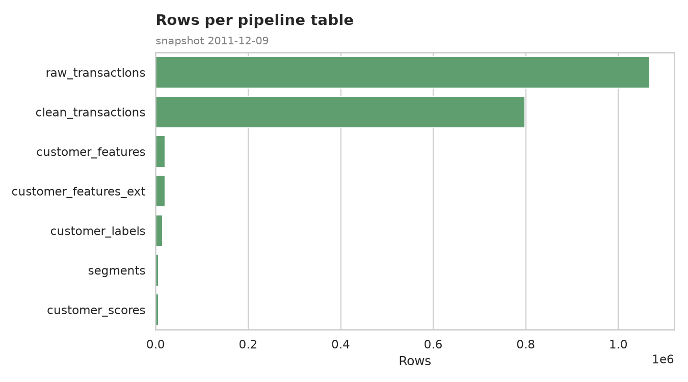
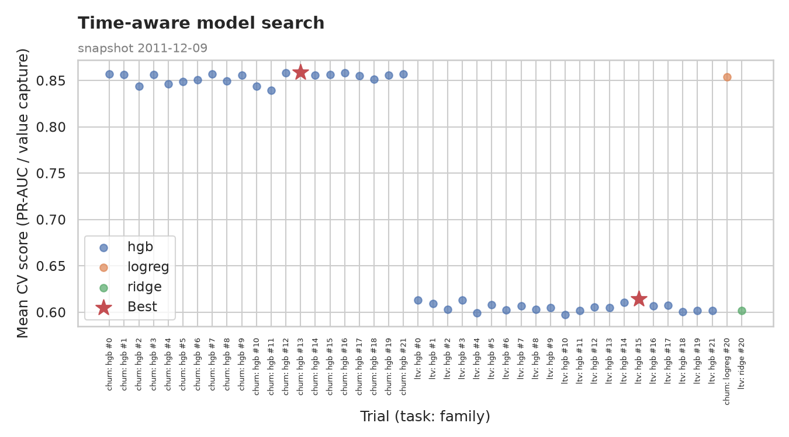
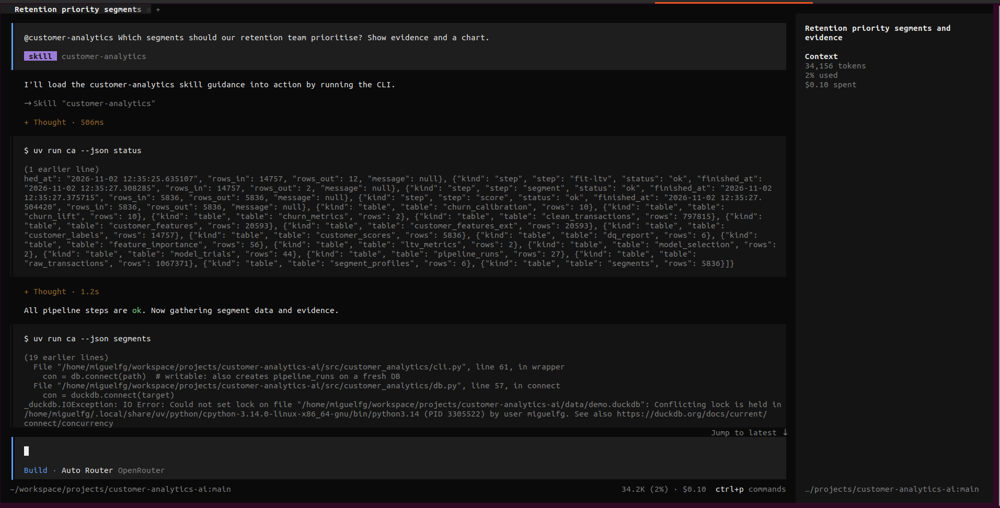
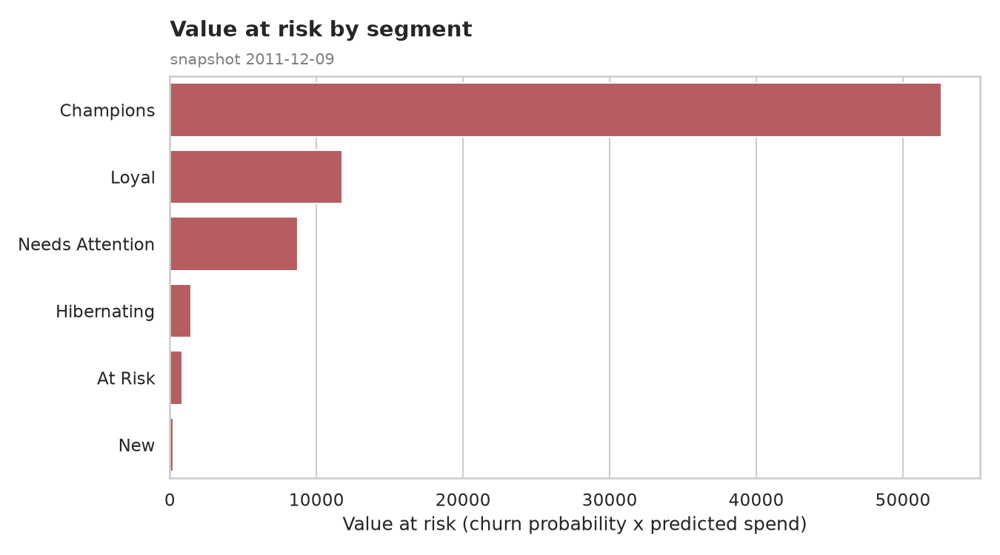
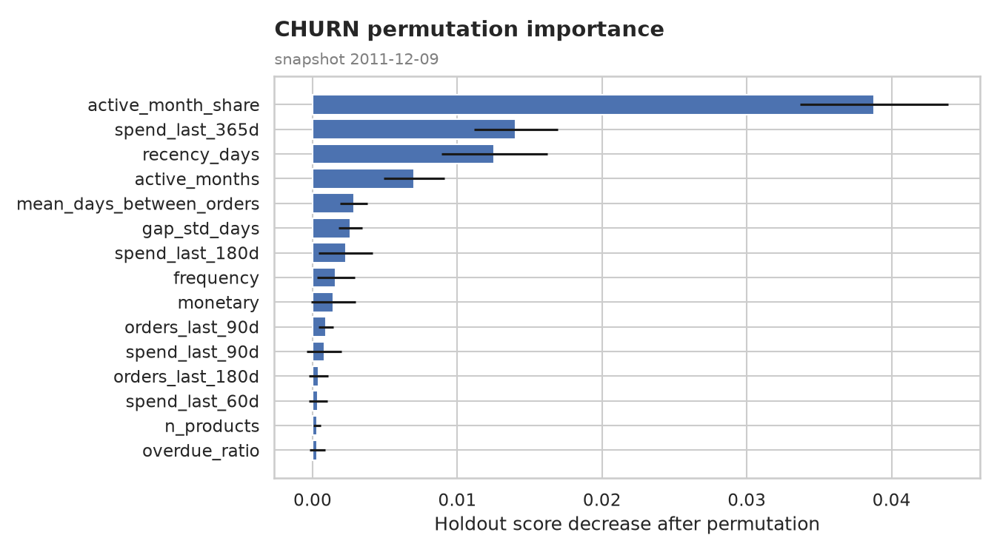
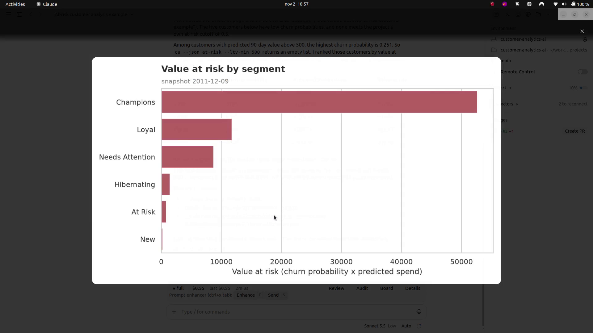
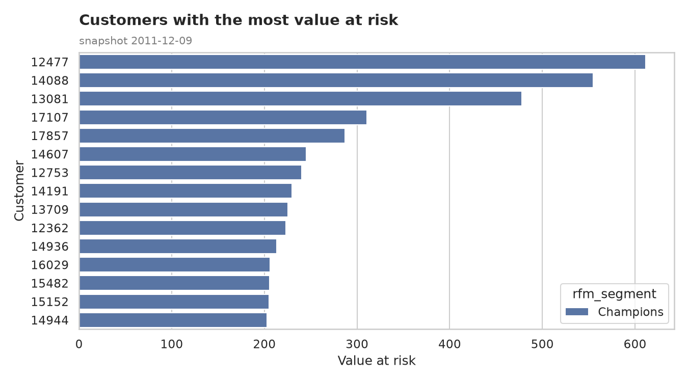
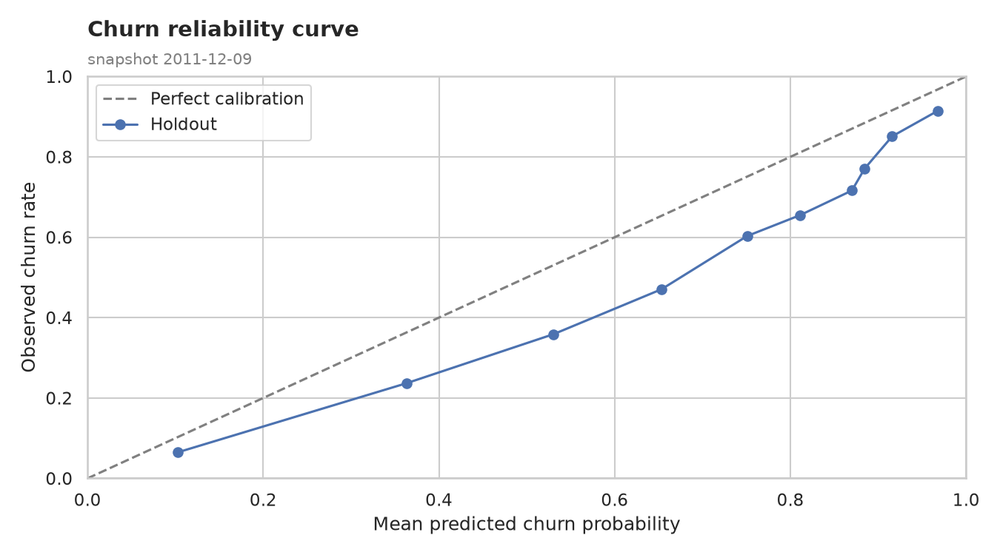

<!-- _class: lead title-slide -->

# Customer Analytics AI
## From retail data to defensible retention decisions

**One CLI**: reproducible pipeline and charts

**Two harnesses**: OpenCode and Claude Desktop
**Evidence**: live outputs, model diagnostics and stated limits

---

<!-- _header: "**The problem** > Evidence > Agent examples > Trust" -->

# What a retention team needs

1. **Which customer groups deserve attention first?**
2. **Which accounts are worth handing to a retention team?**
3. **How good is the model and where are its limits?**
4. **Can an AI agent answer using evidence rather than guesses?**

---

<!-- _header: "" -->
<!-- _class: lead part-product -->

# One inspectable analytics pipeline

**Load → clean → features → tune → model → segment → score → chart**

---

<!-- _header: "**The product** > Evidence > Agent examples > Trust" -->

# A CLI for the whole decision path

- `status` confirms pipeline health
- `segments` identifies customer groups
- `at-risk` ranks action candidates
- `model-report` exposes metrics and features
- `chart` creates evidence for a decision

---

# Model selection is visible, not implicit

**Time-aware tuning** compares candidate models across expanding windows

**Churn quality**: PR-AUC 0.823 vs 0.800 recency baseline

**Business focus**: LTV selection optimises top-decile value capture

---

<!-- _header: "" -->
<!-- _class: lead part-evidence -->

# Two agents, one evidence contract

**Both examples use the same project-local skill and real CLI results**

---

<!-- _header: "The product > **OpenCode example** > Claude Desktop > Trust" -->

# OpenCode loads the skill and checks the pipeline

Example question: Which segments should the retention team prioritise?

---

# The recommendation is backed by charts

Champions carry the largest value at risk; feature importance gives the global drivers behind the churn model.

---

<!-- _header: "The product > OpenCode example > **Claude Desktop** > Trust" -->

# Claude Desktop tests a customer-priority question

The agent uses the shared skill and live CLI outputs to answer a focused request.

---

# It handles an empty hard cutoff honestly

The requested high-value, high-risk filter was empty for this snapshot.

Instead of inventing customers, the agent:

- explains the cutoff result
- ranks the closest decision-ready customers by value at risk
- shows the supporting chart

---

<!-- _header: "" -->
<!-- _class: lead part-trust -->

# Trust comes from traceable outputs

**Live data, explicit model quality and visible limitations**

---

<!-- _header: "The product > OpenCode example > Claude Desktop > **Trust**" -->

# Decision support with clear limits

- Predictions use a **90-day horizon**
- Calibration and feature importance are visible
- Importances are global associations, not causal claims
- Holdout metrics include a documented selection caveat

> The system helps prioritise action. It does not pretend to guarantee outcomes.

---

<!-- _class: lead title-slide -->

# Customer Analytics AI
## A reproducible CLI with agent-ready evidence

**See the full project**

github.com/miguelfg/customer-analytics-ai

Open retail demo data · live agent examples · documented model limits
